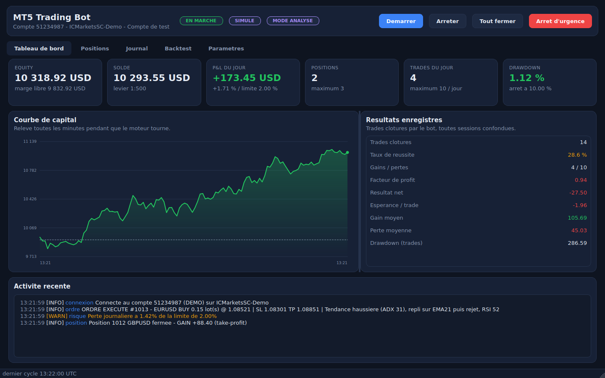

# MT5 Trading Bot

Application de bureau Windows 10/11 pour faire tourner un robot de trading sur
**MetaTrader 5**, en compte démo comme en compte réel.



---

## À lire avant tout le reste

Vous avez demandé « le plus grand pourcentage de réussite tout en étant safe ».
Voici ce que ce programme peut et ne peut pas faire, sans enrobage :

**Le taux de réussite et la rentabilité sont deux choses différentes.** Une
stratégie qui gagne 80 % du temps perd de l'argent si les 20 % de pertes sont
quatre fois plus grosses que les gains. À l'inverse, 35 % de réussite avec un
rapport gain/perte de 3 suffit à être rentable. Le seuil d'équilibre est
`1 / (1 + R:R)`. C'est pour ça que l'interface affiche toujours le taux de
réussite **à côté** du facteur de profit et de l'espérance : le premier chiffre
seul ne veut rien dire.

**Aucun réglage ne garantit un gain.** J'ai mesuré les stratégies incluses sur
des marchés aléatoires générés : l'espérance y tourne autour de 0, ce qui est le
résultat correct — sur du bruit pur, il n'y a rien à gagner. Tout avantage
éventuel doit venir du comportement réel du marché, et il faut le vérifier
vous-même avec l'onglet Backtest, sur les données de **votre** broker.

**Ce qui est réellement sous contrôle ici, c'est le risque.** Le dimensionnement
des positions, les coupe-circuits, le stop obligatoire sur chaque trade : ça,
c'est déterministe, testé, et ça protège le capital. C'est la partie sur
laquelle j'ai mis l'essentiel du travail.

Par défaut, l'application démarre en **mode analyse** : elle calcule les
signaux et les journalise sans envoyer un seul ordre. Il faut une action
explicite pour l'armer, et une confirmation tapée à la main pour un compte réel.

---

## Installation

### Prérequis
1. **Windows 10 ou 11** (le paquet `MetaTrader5` n'existe que sur Windows).
2. **MetaTrader 5** installé, avec un compte ouvert dans le terminal.
3. **Python 3.10 ou supérieur**, téléchargé sur
   [python.org](https://www.python.org/downloads/windows/), en cochant
   **« Add python.exe to PATH »** pendant l'installation.

### Dans le terminal MetaTrader 5
Menu **Outils → Options → Expert Advisors**, cochez
**« Autoriser le trading automatisé »**. Sans ça, tous les ordres seront
rejetés.

### Lancement
Double-cliquez sur **`run.bat`**. Le premier démarrage crée un environnement
Python isolé et installe les dépendances (quelques minutes). Les suivants sont
immédiats.

Pour fabriquer un `.exe` autonome : **`build_exe.bat`** → le résultat est dans
`dist\MT5TradingBot\`.

---

## Prise en main en 5 étapes

1. **Onglet Paramètres → Connexion.** Laissez les champs vides pour utiliser le
   compte déjà ouvert dans le terminal, ou saisissez numéro/serveur/mot de passe.
   Choisissez **Compte DEMO**. Enregistrez.
2. **Onglet Backtest.** Lancez un backtest sur vos symboles. Regardez le nombre
   de trades (moins de 100 ne prouve rien), le facteur de profit et le drawdown.
3. **Tableau de bord → Démarrer**, toujours en mode analyse. Laissez tourner une
   journée. L'onglet Journal montre chaque signal, y compris ceux **refusés** et
   pourquoi — c'est le meilleur moyen de comprendre le comportement du bot.
4. **Paramètres → Exécution → « Autoriser l'envoi d'ordres »** sur le compte
   démo. Laissez tourner plusieurs semaines.
5. Passage en réel : changez le type de compte, l'application vous demandera de
   taper `JE CONFIRME`. Commencez avec un risque par trade réduit.

> Il n'y a pas de raccourci pour l'étape 4. Un bot qui n'a pas tourné plusieurs
> semaines en démo n'a rien démontré.

---

## Ce que fait le bot

### Stratégies

| Logique | Quand elle se déclenche | Profil |
|---|---|---|
| **Suivi de tendance (repli)** | ADX élevé, EMA empilées, repli sur l'EMA rapide puis rejet | Peu de trades, R:R ≥ 1,5, taux de réussite modéré |
| **Retour à la moyenne (range)** | ADX bas, excès sur une bande de Bollinger, RSI extrême, bougie de rejet | Objectif court (la moyenne), réussite plus élevée, R:R plus faible |
| **Confluence** (défaut) | Détecte le régime via l'ADX et bascule vers la logique adaptée ; **ne trade pas** dans la zone de transition | Compromis |

Toutes travaillent uniquement sur des **bougies clôturées** — la bougie en
formation est retirée avant l'analyse, donc un signal ne peut pas se
« repeindre ». Un filtre d'unité de temps supérieure (H4 par défaut) peut
exiger que la tendance de fond valide le sens.

### Gestion du risque

C'est la partie qui compte. Chaque entrée doit franchir **tous** ces filtres :

- **Dimensionnement** : le volume est calculé pour que toucher le stop coûte
  exactement le pourcentage d'equity choisi (0,5 % par défaut). Arrondi
  systématiquement **vers le bas** au pas du broker.
- **Perte maximale par jour** (2 %) et **drawdown maximal** (10 %) : au
  déclenchement, le moteur se suspend et peut fermer les positions. Le
  drawdown ne se réinitialise pas le lendemain — il faut une intervention
  humaine.
- **Plafonds** : positions simultanées, positions par symbole, trades par jour,
  volume maximal.
- **Filtres de marché** : spread maximal, stop qui doit couvrir au moins 1,5 ×
  le spread, marge libre restante minimale.
- **Horaires** : plage de session, jours actifs, coupure du vendredi soir.
- **Temporisation** après un trade sur un symbole.

En cours de vie, chaque position reçoit un **passage au point mort** à +1R puis
un **stop suiveur** à distance ATR. Les deux ne déplacent le stop que dans le
sens qui réduit le risque.

### Garde-fous applicatifs

- Le moteur **refuse de démarrer** s'il découvre un compte réel alors que le
  mode démo est demandé.
- Le bot ne touche **jamais** une position qui ne porte pas son magic number.
- Le mode analyse est l'état par défaut ; l'armement en réel demande une
  confirmation tapée.
- Le mode **simulation hors-ligne** fait tourner toute l'application sur un
  marché fictif, sans MetaTrader 5 — pratique pour découvrir l'interface.
- Toute exception non rattrapée est écrite dans
  `%APPDATA%\MT5TradingBot\logs\app.log` et affichée, plutôt que de faire
  disparaître la fenêtre.

---

## Architecture

```
app/
  __main__.py          point d'entrée, thème, capture globale des erreurs
  config.py            configuration typée + persistance JSON
  logging_setup.py     fichier de log tournant, hooks d'exception
  core/
    broker.py          adaptateur MetaTrader5 (ordres, cotations, historique)
    simulator.py       broker fictif, même surface, pour tester sans MT5
    indicators.py      EMA, RSI, ATR, ADX, Bollinger (pandas/numpy)
    strategies.py      les trois logiques d'entrée
    risk.py            dimensionnement + tous les garde-fous
    engine.py          boucle de trading (thread dédié, sans Qt)
    journal.py         base SQLite : événements, trades, courbe d'equity
    backtest.py        rejeu historique avec les mêmes règles de risque
  ui/
    theme.py           palette + feuille de style
    widgets.py         cartes, badges, graphique dessiné à la main
    engine_bridge.py   passage thread moteur → thread Qt via signaux
    main_window.py     fenêtre, tableau de bord, positions, journal
    panel_settings.py  formulaire de configuration + validations
    panel_backtest.py  backtest dans un thread séparé
tests/                 25 tests, aucun terminal MT5 requis
```

Le moteur ne connaît pas Qt et l'interface ne touche jamais l'API MetaTrader 5
directement. Tous les appels à `MetaTrader5` se font depuis un seul thread, car
ce paquet n'est pas thread-safe.

---

## Tests

```bat
.venv\Scripts\python -m pytest tests -q
```

Les tests couvrent notamment :

- l'absence de biais de look-ahead dans les indicateurs ;
- la perte réelle au stop, comparée au risque demandé ;
- l'élargissement du stop quand le broker impose une distance minimale, **à R:R
  constant** ;
- le fait que le kill switch de drawdown survive au changement de jour ;
- le refus de démarrer en réel quand le démo est demandé ;
- le fait que le mode analyse n'ouvre **aucune** position ;
- une vérification que le backtest ne fabrique pas d'avantage sur un marché
  aléatoire.

---

## Limites connues

- **Windows uniquement** pour le trading réel : le paquet `MetaTrader5` n'existe
  pas ailleurs. Le reste (backtest, interface, simulation) tourne partout.
- Le terminal MetaTrader 5 doit rester **ouvert** : le bot pilote le terminal,
  il ne parle pas directement au broker.
- Le backtest utilise les bougies, pas les ticks. Il ne modélise ni les
  commissions, ni les swaps, ni les gaps de week-end, ni le slippage variable.
  Il compte la perte quand stop et objectif tombent dans la même bougie.
- Le backtest n'applique **pas** le point mort ni le stop suiveur : les
  résultats réels s'en écarteront.
- Aucun filtre d'actualités économiques. Les publications majeures élargissent
  les spreads et provoquent des gaps ; le filtre de spread aide, il ne suffit
  pas toujours.
- Si « mémoriser le mot de passe » est coché, il est stocké **en clair** dans
  `%APPDATA%\MT5TradingBot\config.json`. Par défaut, il ne l'est pas.

---

## Avertissement

Le trading avec effet de levier fait perdre de l'argent à la majorité des
particuliers. Ce logiciel est fourni tel quel, sans garantie d'aucune sorte.
Vous restez seul responsable des ordres passés sur votre compte. N'engagez que
ce que vous pouvez perdre entièrement.
